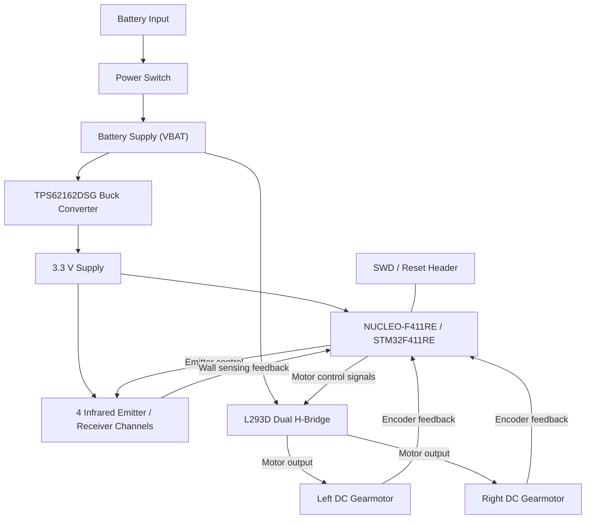

# Micromouse Robot Control PCB

A custom two-layer printed circuit board for a Micromouse robot, developed in KiCad. The hardware integrates an STM32-based controller, infrared wall sensing, dual DC motor control, encoder connections, and battery-powered voltage regulation for autonomous maze-navigation development.

This repository documents the electrical design and PCB implementation. Hardware validation and robot navigation performance are not claimed by the design files alone.

## Hardware Overview

| Subsystem | Implementation | Function |
| --- | --- | --- |
| Microcontroller | STM32F411RE on NUCLEO-F411RE | Central control and peripheral interfaces |
| Motor driver | L293D dual H-bridge | Drives two DC gearmotors |
| Motor feedback | Two 6-pin motor/encoder connectors | Interfaces to the gearmotor encoders |
| Wall sensing | 4 x INL-5AMIR15 IR emitters and 4 x SFH 313 FA receivers | Detects nearby maze walls |
| IR switching | 4 x BS170 MOSFETs | Controls the IR emitters |
| Voltage regulation | TPS62162DSG buck converter | Generates the 3.3 V supply rail |
| Power input | 2-pin battery connector and 500SSP1S2M2QEA switch | Connects and switches battery power |
| Debug interface | 4-pin SWD connector | Provides programming/debug signal access |

## System Block Diagram



The battery rail supplies the motor driver and the buck regulator. The regulated 3.3 V rail serves the microcontroller and infrared sensing circuitry. The STM32 controls the two motors and receives encoder and infrared sensor signals for closed-loop navigation.

## Hardware Design

### Microcontroller and Debugging

The design uses an **ST NUCLEO-F411RE** board built around the **STM32F411RE** microcontroller. The controller interfaces with the wall sensors, motor driver, and motor encoders. A separate header exposes SWD and reset-related signals for debugging.

### Drive System

An **L293D** dual H-bridge controls two DC gearmotors. Each motor connects through a 6-pin interface that also accommodates encoder signals. The motor power path uses the battery supply, while control and feedback signals connect to the STM32.

### Infrared Wall Detection

Four sensing channels provide wall-detection inputs. Each channel combines an **INL-5AMIR15** infrared emitter, an **SFH 313 FA** infrared receiver, and a **BS170** MOSFET-based emitter control circuit. The microcontroller controls illumination and reads the corresponding sensor outputs.

### Power Distribution

A two-pin battery connector and mechanical power switch feed the **VBAT** net. The **TPS62162DSG** buck converter produces the **3.3 V** supply for the low-voltage electronics. Battery, regulator, and motor-driver requirements must be checked against the selected battery and motor operating conditions before assembly.

## PCB and Design Files

The PCB is designed as a **two-layer board** in **KiCad**. The project includes hierarchical schematic sheets, a PCB layout, imported component libraries and 3D models, a bill of materials, and existing fabrication outputs.

```text
.
├── team3_micromouse_202526_7F5.kicad_pro
├── team3_micromouse_202526_7F5.kicad_sch
├── team3_micromouse_202526_7F5.kicad_pcb
├── Microcontroller.kicad_sch
├── motors.kicad_sch
├── IR.kicad_sch
├── power_module.kicad_sch
├── team3_BOM_micromouse_202526_7F5.xlsx
├── imports/
├── gerber/
└── README.md
```

The `imports/` directory contains third-party symbols, footprints, and mechanical models. The `gerber/` directory contains previously generated fabrication files and should not be assumed to represent the latest schematic revision.

## Opening the Project

1. Install **KiCad 9** or a version compatible with the project files.
2. Open `team3_micromouse_202526_7F5.kicad_pro` in KiCad.
3. Review the hierarchical schematic and the PCB layout.
4. Resolve any local symbol, footprint, or 3D-model library paths if prompted.
5. Run electrical rules checking (ERC) and design rules checking (DRC) before generating new production files.

## Development Status

**Hardware design in progress.** The supplied archive contains PCB and schematic design files, but does not establish a completed, assembled, or validated robot. The schematic sheets have been revised more recently than the existing PCB and fabrication outputs; review their consistency before ordering boards.

Current engineering checks include supply-voltage compatibility, motor-driver and switch current ratings, regulator loading, encoder and sensor pin assignments, and board-level ERC/DRC results. Firmware and measured test results are not included in the supplied hardware archive.

## Project Attribution

Maintained by **Angelo Duenas**. Original design credits are retained in the schematic title blocks.
